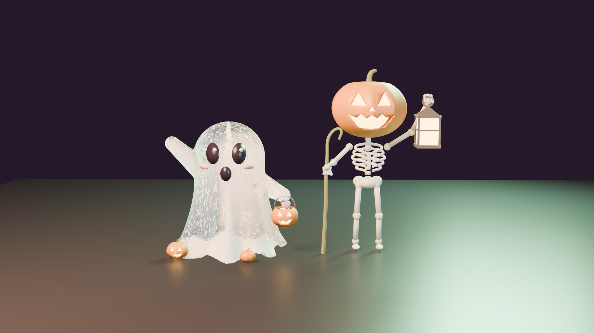

# Halloween Figurines (No Man's Sky)



Two new Halloween cockpit figurines for **No Man's Sky**, sold in the Quicksilver shop: **Boo**, a see-through sheet ghost with a glowing pail of sweets, and **Lantern Jack**, a pumpkin-headed skeleton holding up a glowing lantern. Flickering candle-lit jack-o'-lanterns, a cursed green haze rolling round the dash, and wobbling heads like the game's own figurines. Nothing in the game is replaced.

- New items: none of the game's figurines are replaced
- Multiplayer: other players without the mod won't see them
- Uninstall: remove the figurine from your ship, then delete the mod folder

**Getting the figurines:** buy them for 3,200 Quicksilver each from the Quicksilver Synthesis Companion on the Space Anomaly, then install one in your starship's inventory.

**Players:** download the ready-made mod from Nexus Mods (or from this repo's Releases), then extract the
`HalloweenFigurines` folder into `No Man's Sky\GAMEDATA\MODS\`.

| Figurine | |
|---|---|
| **Boo** | A see-through sheet ghost waving hello, with a glowing jack-o'-lantern pail of sweets |
| **Lantern Jack** | A skeleton with a grinning jack-o'-lantern head, holding up a glowing lantern and leaning on a crooked staff |

## Building it yourself

Nothing from the game is stored in this repo. The build reads the game files it needs straight from your own
install, then generates everything else (models, materials, textures, particles, shop entries, text).

### Requirements
- Python 3.10+ with `pip install -r requirements.txt` (numpy, Pillow, hgpaktool)
- [MBINCompiler](https://github.com/monkeyman192/MBINCompiler/releases) matching your game version:
  put `MBINCompiler.exe` in `tools/bin/` or set the `MBINCOMPILER` environment variable
- [Blender](https://www.blender.org/) 5.2, only if you want to change the models

### Build
```
python tools/build.py --game "C:\Program Files (x86)\Steam\steamapps\common\No Man's Sky"
```
The finished mod is zipped into `dist/`. Add `--install` to copy it straight into your `GAMEDATA\MODS` folder.
Every build runs the release checks in `tools/check.py` (scene links, materials and textures, particle settings,
mesh bounds and vertex budget, shop and figurine-list entries) and refuses to package if any fail.

### What's where
| Path | What it is |
|---|---|
| `design/halloween_v2.blend` | The models. Text blocks inside: `hw_lib` (shared helpers), `hw_pumpskel` (builds Lantern Jack), `hw_export` (writes `design/v2_*.pkl`) |
| `tools/model.py` | Builds the figurine scenes, materials, palette and flipbook textures, and the haze particles |
| `tools/tables.py` | Shop, technology, reward, product and figurine-list entries, and the in-game text |
| `tools/icons.py` | Shop icons and hero images, rendered from the built meshes |
| `tools/build.py` | Extract → generate → assemble → check → zip |
| `tools/check.py` | Release checks |
| `tools/common.py` | Names, IDs, prices and the figurine definitions |
| `tools/mod_readme.txt` | The readme that ships inside the mod |
| `nexus/` | Nexus Mods page text (BBCode) and images |

### How it works
Each figurine is a copy of the game's Polo figurine scene with its meshes replaced: the head hangs off the
figurine's head joint (that's what wobbles), the body is static, and the game's own pedestal and glow ring are
kept. Lit parts share one small palette texture, so a figurine is a handful of meshes with no texture of its own.
The candle glow is an unlit flipbook that flickers, and the green haze is the game's haunted-frigate particle
effect, shrunk to dashboard size.

The cockpit figurine list (`BOBBLEHEADCUSTOMISATIONDATA.MBIN`) can't be merged, so it ships as a complete file.
It also lists the figurines from my other figurine mods, and theirs list these, so they all work together.

## Credits
- Built with [MBINCompiler](https://github.com/monkeyman192/MBINCompiler) and [HGPAKtool](https://github.com/monkeyman192/HGPAKtool)
- No Man's Sky is © Hello Games. This is an unofficial fan mod.

Author: MajorRoyMcCalluster
